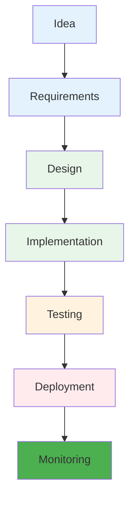
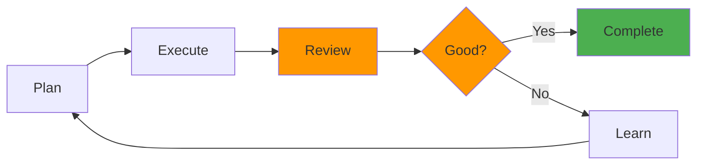
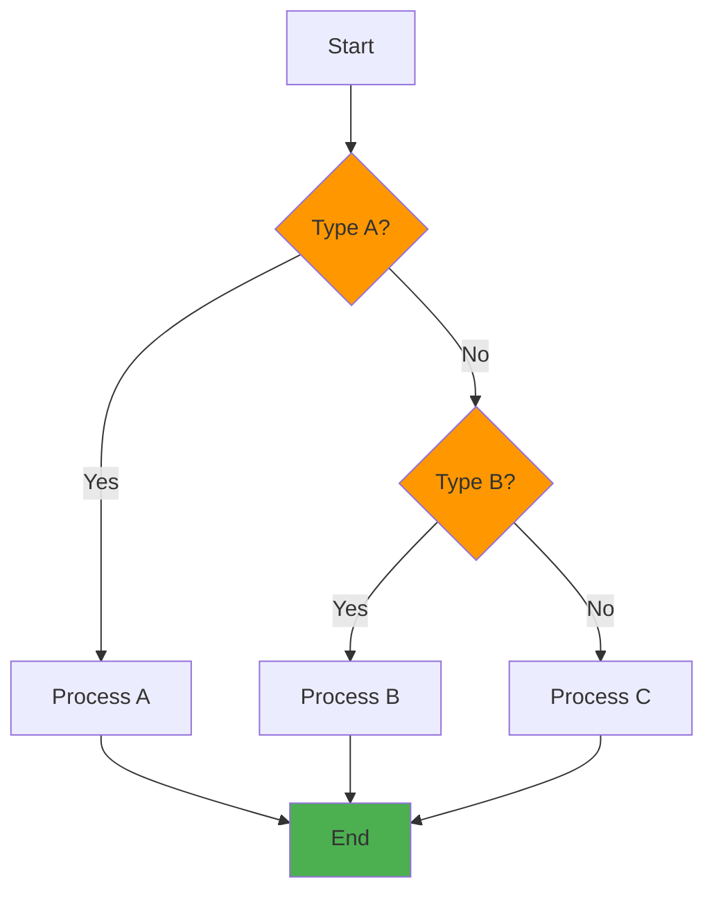
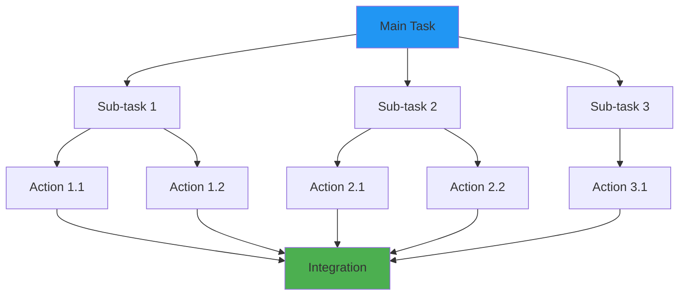
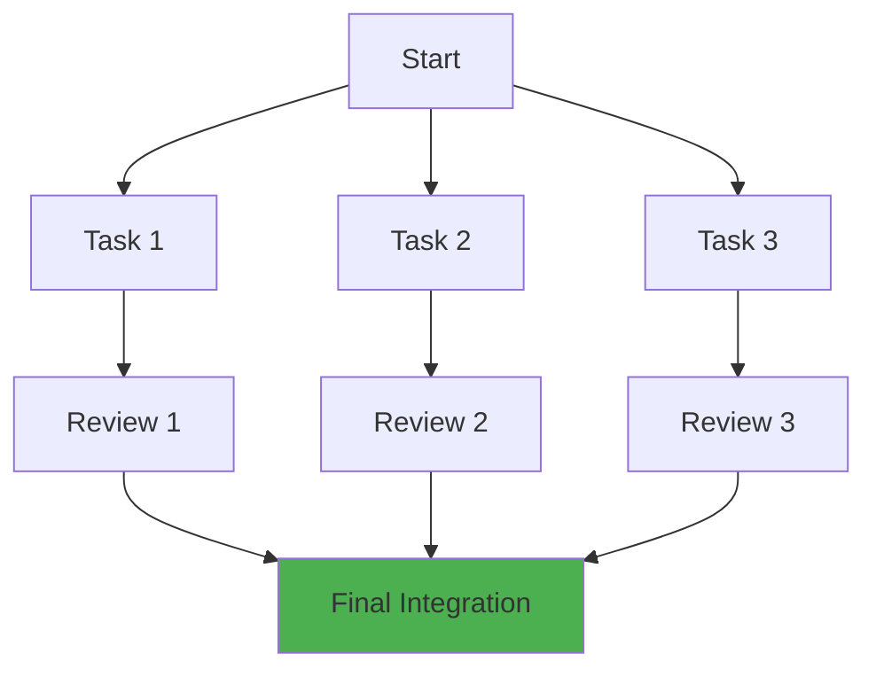
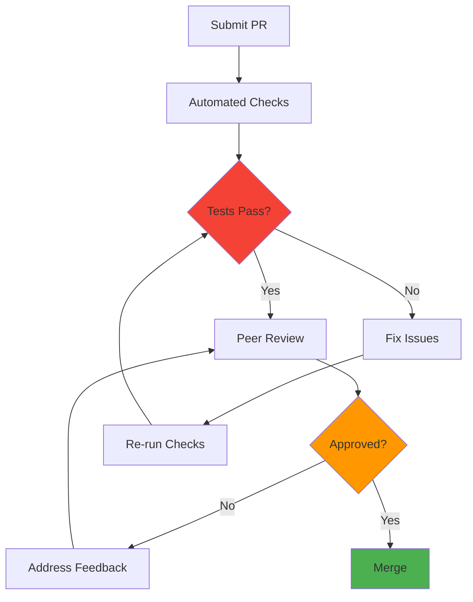
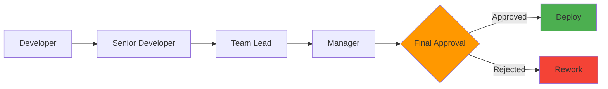

## Process Flow Templates

### Linear Development Process

### Iterative Process with Feedback

### Decision Tree Process

## Task Management Templates

### Task Breakdown Structure

### Parallel Task Execution

## Review Process Templates

### Code Review Workflow

### Multi-Level Review

